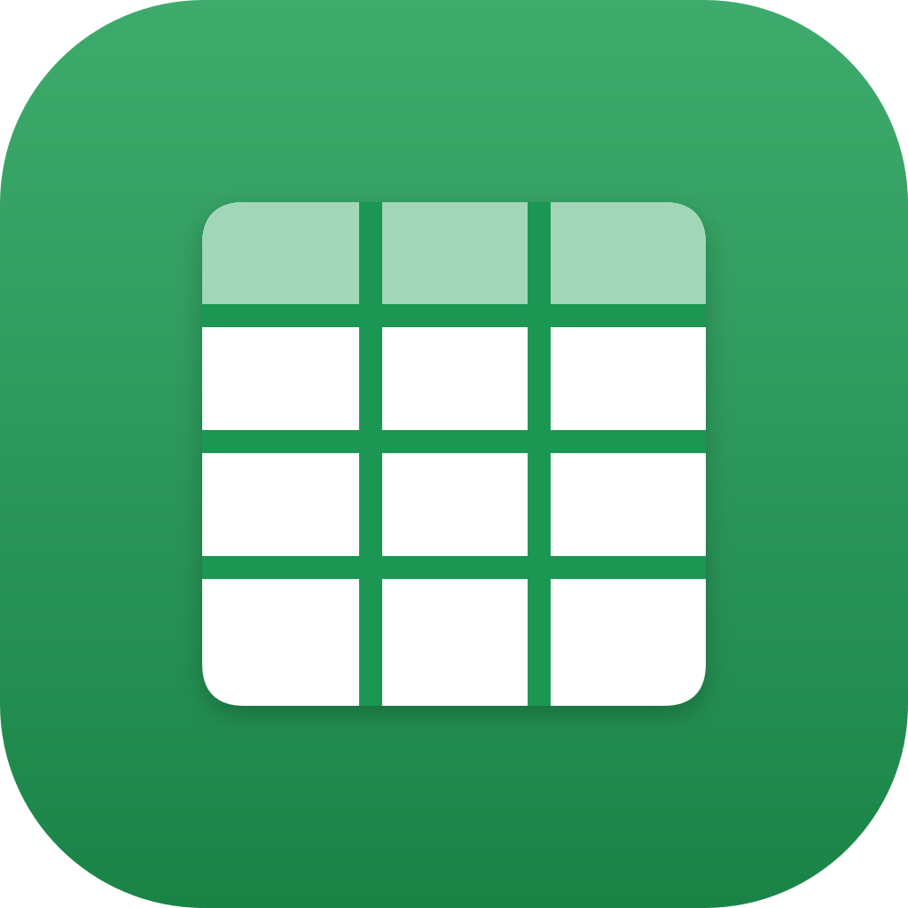

<h1 align="center">NERDS Grid</h1>

<b>Spreadsheets and data.</b> Part of the NerdsCraft Suite: install it with
<a href="https://github.com/nerds-coach/nerds-launcher/releases/latest">NERDS Launcher</a>.

NERDS Grid is [GridCraft](https://github.com/storytold/gridcraft), ArtCraft's free and open-source app, built
with the NERDS icon. This repository holds no app code: its [build workflow](.github/workflows/build.yml)
takes each official GridCraft release, swaps in the NERDS icon (`app-icon/`, laid over the app's own
`assets/app-icon/`), builds it for Windows and macOS on GitHub, and publishes it under
[Releases](../../releases) with the same version and file names. It checks for a new release every
six hours.

The app's code and its license (MIT OR Apache-2.0) are GridCraft's: see
[storytold/gridcraft](https://github.com/storytold/gridcraft). The NERDS icon is a NERDS brand asset.

To build now: **Actions → Build → Run workflow** (tick *force* to rebuild a version already here).
